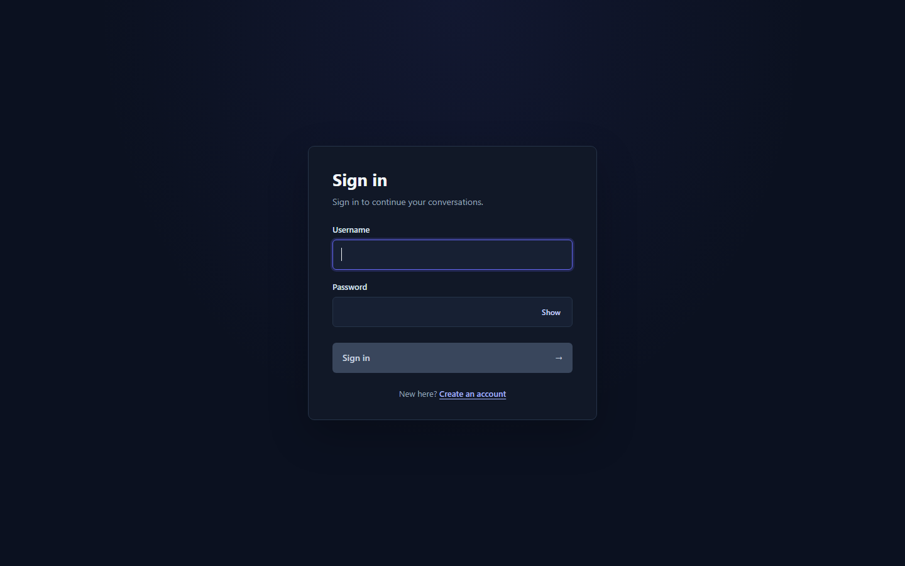
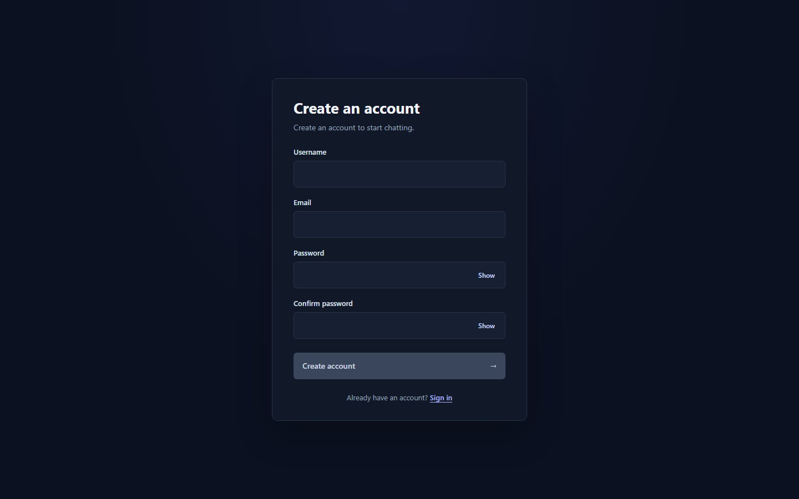
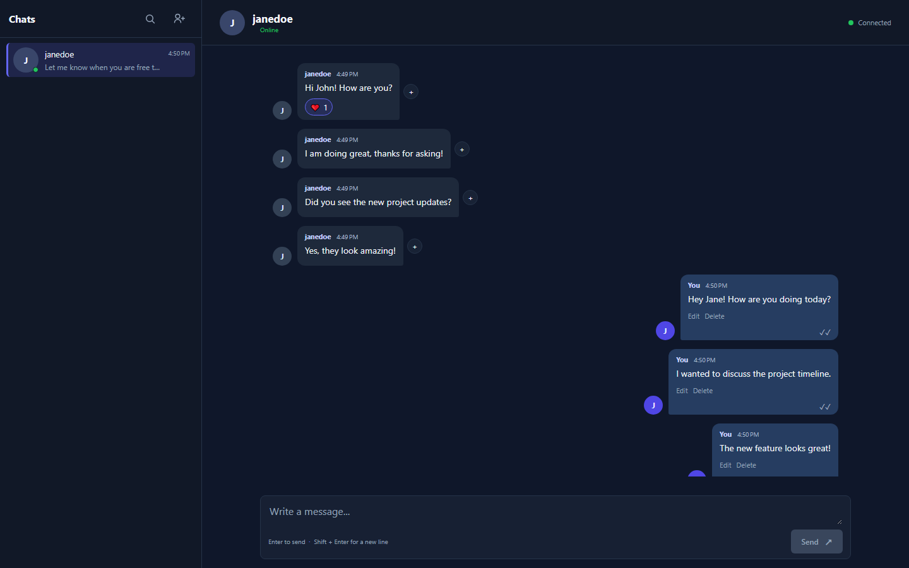
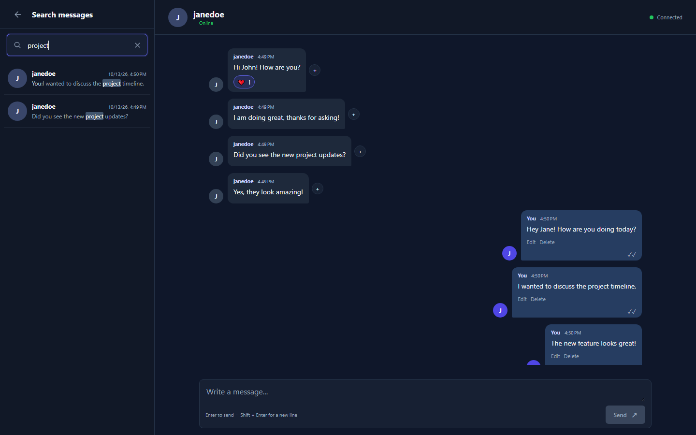
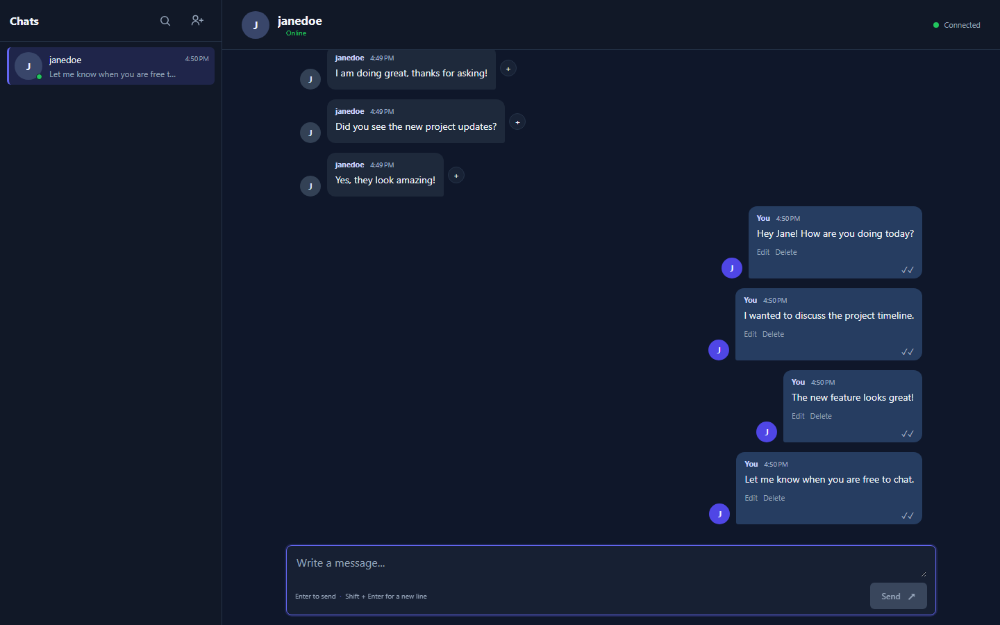

# Chat Application


A one-to-one chat application built with an ASP.NET Core Web API and an Angular client. It combines authenticated conversation and message APIs with SignalR for real-time messaging, presence, typing indicators, reactions, and delivery/read updates.

> Feature and configuration details below were checked against the repository source. The application, builds, and tests were not run as part of this documentation update.

## Contents

- [Screenshots](#screenshots)
- [Features](#features)
- [Technology Stack](#technology-stack)
- [Architecture](#architecture)
- [Prerequisites](#prerequisites)
- [Getting Started](#getting-started)
- [Configuration](#configuration)
- [API Reference](#api-reference)
- [SignalR](#signalr)
- [Data and Security](#data-and-security)
- [Potential Improvements](#potential-improvements)
- [Contributing](#contributing)
- [License](#license)

## Screenshots

The following screenshots were captured from the running application using isolated demo accounts.

| Login | Registration |
| --- | --- |
|  |  |

| Active conversation | Message search |
| --- | --- |
|  |  |

| Reactions and receipts |
| --- |
|  |

See [screenshot capture notes](docs/screenshots/README.md) for guidance.

## Features

The following capabilities have implementation paths in the current API and Angular source:

- Account registration and login with JWT bearer authentication.
- Username search and one-to-one conversation creation.
- Real-time text messages, paged conversation history, and message-context navigation from search results.
- Message search across the signed-in user's conversations, with paginated results.
- Delivery and read receipts, per-conversation unread counts, and automatic reconciliation of pending delivery acknowledgements.
- Typing notifications and online/offline presence, including a persisted last-seen timestamp.
- Sender-only message editing and soft deletion. Deleted messages retain their record but no longer expose their original content in message responses.
- Emoji reactions using the supported set: 👍, ❤️, 😂, 😮, 😢, and 🙏. A user can toggle their reaction or switch it to another supported emoji.
- Responsive chat layout with a mobile conversation-list view and connection/retry status.

The repository currently implements direct, two-participant conversations. Group chats, file attachments, and voice/video calls are not evidenced in the current implementation and are not represented as available features here.

## Technology Stack

| Area | Technologies verified in the project |
| --- | --- |
| Backend | ASP.NET Core targeting .NET 9 (`net9.0`); ASP.NET Core Identity; JWT bearer authentication |
| Data access | Entity Framework Core SQL Server provider 9.0.6; ASP.NET Core Identity EF Core 9.0.6 |
| Database | Microsoft SQL Server |
| Frontend | Angular 21.2; TypeScript `~5.9.2`; RxJS `~7.8.0` |
| Real-time | ASP.NET Core SignalR; `@microsoft/signalr` `^10.0.11` |
| Frontend tooling | Angular CLI `^21.2.24`; npm (the package metadata specifies npm `11.19.0`) |

The Angular versions above are the dependency ranges declared by the project; `ChatClient/package-lock.json` is the install lockfile. Install dependencies with `npm ci` to use the locked dependency tree.

## Architecture

The Angular client calls the API through same-origin relative paths. Its development-server proxy forwards `/api` and `/chatHub` to the API's HTTP development endpoint (`http://localhost:5083`). The HTTP controllers handle account, user-search, conversation, history, search, and message-mutation requests. The authenticated SignalR hub handles live chat interactions and broadcasts updates to the two participants.

Responsibilities are separated across controllers and hub endpoints, service interfaces/implementations, DTOs, EF Core persistence, and Angular feature areas. `ConversationService` owns conversation and message operations; dedicated services handle authentication, user search, presence, and reactions.

```text
.
├── ChatApi/
│   ├── Controllers/       # Authentication, users, conversations, message mutations
│   ├── Data/              # EF Core DbContext and mappings
│   ├── DTOs/              # API request and response contracts
│   ├── Hubs/              # Authenticated SignalR chat hub
│   ├── Migrations/        # EF Core schema history
│   ├── Models/            # Identity extension and chat entities
│   └── Services/           # Authentication, chat, presence, reactions, user search
├── ChatApi.Tests/         # Backend unit tests
└── ChatClient/
    ├── public/
    └── src/app/
        ├── core/          # Authentication, interceptor, route guard
        └── features/      # Auth, chat, and user-search UI/data access
```

## Prerequisites

- .NET 9 SDK.
- Node.js 20.19+, 22.12+, or 24+ and npm, compatible with Angular 21.
- A reachable Microsoft SQL Server instance and permission to create/update the application database.
- The `dotnet-ef` CLI 9.x tool if you want to apply migrations manually.

## Getting Started

### Configure and run the API

From the repository root, move into the API project and configure a SQL Server connection string and JWT signing key for your local environment. The project already has a User Secrets ID; keep machine-specific values and secrets out of committed settings.

```powershell
cd ChatApi
dotnet restore ChatApi.sln
dotnet user-secrets set "ConnectionStrings:DefaultConnection" "Server=<SQL_SERVER>;Database=<DATABASE>;Trusted_Connection=True;Encrypt=True;TrustServerCertificate=True;"
dotnet user-secrets set "Jwt:SigningKey" "<replace-with-a-random-secret-at-least-32-bytes-long>"
```

The API validates that the JWT signing key contains at least 32 UTF-8 bytes. `Jwt:Issuer`, `Jwt:Audience`, and `Jwt:ExpirationMinutes` are also configurable; use values consistent with the client/API deployment. User Secrets are loaded by the ASP.NET Core development environment.

For manual schema setup, install the EF CLI once and apply the checked-in migrations:

```powershell
dotnet tool install --global dotnet-ef --version 9.0.6
dotnet ef database update --project ChatApi.csproj
```

Then build and run using the checked-in HTTP launch profile:

```powershell
dotnet build ChatApi.sln
dotnet run --launch-profile http
```

The API listens at `http://localhost:5083` for that profile. In the Development environment, the application also applies pending EF Core migrations automatically on startup. Swagger UI is enabled only in Development at `/swagger`.

### Configure and run the Angular client

In a second terminal, from the repository root:

```powershell
cd ChatClient
npm ci
npm start
```

The Angular development server normally serves the client at `http://localhost:4200`. `angular.json` configures `src/proxy.conf.json` automatically; it forwards API and SignalR traffic to `http://localhost:5083`. Start the API on that port, or update the proxy target if using a different local HTTP port.

## Configuration

| Setting | Purpose | Current behavior |
| --- | --- | --- |
| `ConnectionStrings:DefaultConnection` | SQL Server database connection | Required by the API; override the checked-in machine-specific connection target with User Secrets or environment configuration. |
| `Jwt:Issuer` | JWT issuer validation and token creation | Configurable in API settings. |
| `Jwt:Audience` | JWT audience validation and token creation | Configurable in API settings. |
| `Jwt:SigningKey` | HMAC signing and validation key | Required; provide through User Secrets or a deployment secret store. |
| `Jwt:ExpirationMinutes` | Access-token lifetime | Configurable; the checked-in default is 60 minutes. |
| Angular API base paths | REST and SignalR destinations | The client uses `/api` and `/chatHub`; the development proxy target is in `ChatClient/src/proxy.conf.json`. |

The API currently does not register a CORS policy. The checked-in development proxy keeps browser requests same-origin. A deployment using separate frontend and API origins must configure and validate an explicit API CORS policy for both HTTP and SignalR traffic, or route them through a same-origin reverse proxy. No frontend environment-based API URL is currently configured.

## API Reference

All `/api/users` and `/api/conversations` endpoints require `Authorization: Bearer <access-token>`. Registration and login are public. The token is returned by login and used by the Angular HTTP interceptor; the browser client stores it in `sessionStorage` for the current tab session.

| Method | Endpoint | Purpose |
| --- | --- | --- |
| `POST` | `/api/auth/register` | Register with username, email, and password. |
| `POST` | `/api/auth/login` | Authenticate and return an access token. |
| `GET` | `/api/users/search?username={term}` | Search up to 20 other users by username. |
| `POST` | `/api/conversations/open/{otherUserId}` | Open or create a one-to-one conversation. |
| `GET` | `/api/conversations` | List the signed-in user's conversations, previews, unread counts, and presence snapshots. |
| `GET` | `/api/conversations/search/messages?q={term}&page=1&pageSize=20` | Search messages in the user's conversations. |
| `GET` | `/api/conversations/{conversationId}/messages?pageSize=30&before={cursor}` | Read a conversation history page; `before` is an opaque pagination cursor. |
| `GET` | `/api/conversations/{conversationId}/messages/{messageId}/context` | Read a page around a message, used to navigate from a search result. |
| `PUT` | `/api/conversations/{conversationId}/messages/{messageId}` | Edit the caller's own message. The JSON body contains `content`. |
| `DELETE` | `/api/conversations/{conversationId}/messages/{messageId}` | Soft-delete the caller's own message. |

## SignalR

The authenticated hub is mounted at `/chatHub`. The client supplies the JWT using SignalR's `accessTokenFactory`; the API accepts the `access_token` query parameter for hub requests. The client enables automatic reconnect.

### Client-to-server hub methods

| Method | Arguments | Behavior |
| --- | --- | --- |
| `SendMessage` | `conversationId`, `content` | Persist and broadcast a text message; returns the saved message DTO. |
| `ReactToMessage` | `conversationId`, `messageId`, `emoji` | Add, switch, or remove the caller's reaction. |
| `TypingStarted` / `TypingStopped` | `conversationId` | Notify the other participant about typing state. |
| `AcknowledgeDelivered` | `messageId` | Record delivery and notify the sender. |
| `AcknowledgeRead` | `conversationId`, `lastReadMessageId` | Mark incoming messages through the boundary as read, notify senders, and update unread count. |
| `ReconcilePendingDeliveries` | none | Reconcile undelivered messages for the connected user. |

### Server-to-client events

| Event | Payload |
| --- | --- |
| `ReceiveMessage` | Saved message DTO (`id`, `conversationId`, `senderId`, `content`, timestamps, and reactions). |
| `MessageStatusUpdated` | Message DTO with delivery/read timestamps. |
| `MessageEdited` / `MessageDeleted` | Updated message DTO. |
| `UnreadCountUpdated` | `{ conversationId, unreadCount }`. |
| `UserTyping` | `{ conversationId, userId, displayName }`. |
| `UserStoppedTyping` | `{ conversationId, userId }`. |
| `UserOnline` / `UserOffline` | `{ userId, isOnline, lastSeenAt, changedAt }`. |
| `MessageReactionUpdated` | `{ conversationId, messageId, reactions }`; each reaction includes `emoji`, `count`, and `reactedByCurrentUser`. |

The hub broadcasts message and presence changes only to the relevant conversation participants/observers. Editing and deletion are initiated through HTTP and then broadcast to both participants through the hub context.

## Data and Security

- ASP.NET Core Identity stores users in the SQL Server database. The application user adds `LastSeenAt` to the Identity user model.
- EF Core migrations manage Identity tables and the `Conversation`, `Message`, and `MessageReaction` entities.
- Conversation access is checked against its two participants. Message edit/delete operations are restricted to the original sender.
- Password requirements are configured in Identity: at least eight characters, including uppercase, lowercase, numeric, and non-alphanumeric characters; email addresses must be unique.
- JWT validation checks issuer, audience, lifetime, and signing key. The hub and conversation/user APIs require authentication.
- The access token is kept in browser `sessionStorage`; do not treat this as protection against script execution in the browser.
- Active presence connections are tracked in process memory. Last-seen timestamps are persisted, but online state is not shared across API instances; a multi-instance deployment would need distributed presence coordination.
- Configure database credentials and JWT signing material outside committed configuration. The checked-in connection target is machine-specific and should be overridden for your environment.

## Potential Improvements

These are possible follow-up projects, not features claimed as implemented:

- Add distributed presence and SignalR scale-out support for multi-instance hosting.
- Add deployment-specific frontend/API configuration and a deliberate production CORS or same-origin routing setup.
- Expand automated integration coverage across authenticated API and SignalR workflows.
- Add group conversations or attachment support if those product requirements emerge.

## Contributing

Contributions are welcome. Open an issue to discuss a substantial change, keep pull requests focused, and include tests for behavior changes. Before submitting, run the relevant checks:

```powershell
cd ChatApi
dotnet test ChatApi.sln
cd ..\ChatClient
npm test
```

These commands are provided for contributors; they were not run while preparing this README.

## License

No license has been specified in this repository. All rights remain with the respective copyright holders unless a license is added.